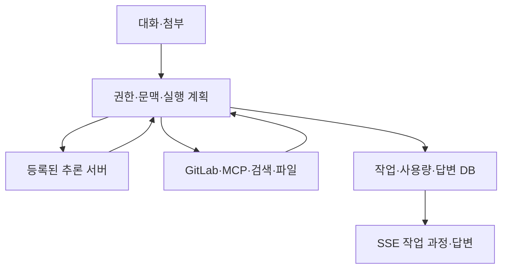

# 폐쇄망 AI 에이전트 운영·검증

## 기존 구조와 확장

FastAPI SSE, `GenerationJobs`, DB 대기열, 자동 라우팅, Terminal MCP, 문서 검색을 재사용합니다. 추가 대기열이나 별도 Agent 엔진은 만들지 않았습니다. 모델은 다음 작업을 선택하고 애플리케이션이 권한·입력·실행 상태·저장·검증을 관리합니다. README, 이미지, 도구 결과의 지시문은 사용자 권한이 아닙니다. 단순 인사는 추가 라우팅 모델 호출을 생략하며 실제 모델 장애를 테스트 랜덤 응답으로 대체하지 않습니다.



## 공개 추론과 Generation Trace

vLLM `reasoning`·이전 버전 `reasoning_content`, Ollama `message.thinking`을 답변과 구분합니다. 모델의 별도 추론 출력 지원과 운영자의 공개 설정이 모두 켜져야 표시합니다. 기본 공개는 꺼짐이며 내부 사고나 답변 본문의 `<think>` 문자열을 추정해서 보여주지 않습니다. 서버의 모델별 reasoning parser도 필요합니다.

개별 실행은 `backend/.env`, Compose는 루트 `.env`에 설정합니다. 모델 ID는 실제 `GET /v1/models`의 `--served-model-name`과 맞추고 기능은 운영 화면에서 검사하세요. `models` 배열이 있으면 모델별 설정이 우선합니다.

```dotenv
LLM_TEST_MODE=false
LLM_CONNECTIONS_JSON='[{"id":"internal","name":"사내 모델","provider":"vllm","base_url":"http://192.168.0.10:50301/v1","model":"gemma-4-31b-it","supports_tools":true,"supports_vision":true,"supports_reasoning":true,"reasoning_visibility":"public","context_window":16384,"max_output_tokens":2048,"max_concurrent":3}]'
```

vLLM 주소는 `/v1`까지, Ollama는 `/api` 없는 서버 루트를 지정합니다. `gpt-oss-120b`도 같은 어댑터를 사용합니다. 모델 이름만으로 기능 성공을 보장하지 않습니다. Gemma 4는 [Google 공식 모델 카드](https://huggingface.co/google/gemma-4-31B-it)와 [폐쇄망 설치 매뉴얼](docs/offline-models/02-chat-and-vision.md)을 참고하세요. Qwen은 배포 예시에 포함하지 않습니다.

| SSE 이벤트 | 실제 전달 내용 |
| --- | --- |
| `activity` | 단계 시작·완료·오류·취소, 고정 작업 ID·요청 ID·시각·경과 시간 |
| `reasoning_delta` | 공개를 허용한 모델 서버의 별도 추론 텍스트 |
| `delta` | Markdown 답변. 근거 검토가 필요한 초안은 검토 후 표시 |
| `generation_metrics` | 실제 호출 측정·서버 보고 토큰. 추정치는 별도 표시 |
| `sources`, `artifact`, `done` | 조회한 출처·생성 파일·저장된 최종 메시지 |

메시지에 `generation_trace` 필드가 추가됩니다. 기존 `tools` 필드와 SSE 형식은 유지하며 저장 기록은 작업당 최신 상태로 정리합니다. 시작·완료 이벤트는 같은 ID로 연결하고 병렬 작업은 완료 순서와 무관하게 상관관계를 유지합니다.

추론은 최대 64,000자, 단계는 최대 240개입니다. 메모리에서 합쳐 약 0.75초 간격과 완료 시 DB에 저장합니다. 프론트엔드는 약 80ms 간격으로 텍스트 업데이트를 묶습니다. 비밀값·자격 증명 패턴을 검사하며 토큰이 청크에 나뉘어도 마스킹합니다. 보안 버퍼 때문에 짧은 추론은 채널 종료 시 표시될 수 있습니다.

작업 과정은 생성 중 펼쳐지고 완료 후 접힙니다. 새로고침·취소·재시도·답변 버전·분기에 기록을 보존합니다. 공유 대화에는 개인 추론·도구 로그를 전달하지 않습니다. 서버 중단은 DB 임대 만료 시 오류로 정리하며 확인하지 못한 실제 종료·실행 시간을 만들지 않습니다.

## GitLab 자연어 사용과 권한

기존 사용자별 OAuth 2.0/PKCE·암호화 토큰을 사용하며 같은 서버의 여러 계정도 연결할 수 있습니다. 시작 시 기존 연결 ID·토큰·작업공간을 유지하는 제약 업그레이드를 수행합니다. SQLite는 원자적 교체·외래 키 검사, PostgreSQL은 잠금 후 제약 변경을 사용합니다. 업데이트 전 DB 백업을 보관하세요.

```text
내 GitLab에서 로그인 관련 프로젝트 찾아줘.
@gitlab team/service의 main과 develop 차이를 설명해줘.
@gitlab team/service 이슈 목록을 찾아줘.
@gitlab team/service 이슈를 생성해줘.
@gitlab team/service MR !27에 리뷰 댓글을 작성해줘.
@gitlab team/service의 로그인 오류를 수정하고 테스트한 뒤 커밋·푸시하고 MR을 생성해줘.
@gitlab team/service와 team/other의 로그인 처리를 비교 분석해줘.
```

프로젝트·그룹·브랜치·커밋·이슈·MR·파일 탐색은 Terminal MCP 없이 GitLab API로 동작합니다. 코드 검색·승인 API가 서버 버전·CE 권한에서 지원되지 않으면 사용 불가로 표시합니다. 실제 파일을 읽은 뒤에만 SHA·라인·경로 링크를 인용합니다. 서버·계정별 대상이 겹칠 때만 선택을 요청합니다. API 탐색은 요청당 최대 24회이며 목록·발췌 크기도 제한합니다.

AST·Tree-sitter 분석, 수정·테스트에는 [Terminal MCP](TERMINAL_MCP.md)가 필요합니다. 다중 저장소 분석은 요청당 최대 3개 읽기 전용 작업공간에서 선택적으로 소스를 읽습니다. 원격 소스가 바뀌면 새 스냅샷을 사용합니다. 실제 읽은 코드와 정적 호출·의존성 후보를 구분하며 동적 실행 경로까지 검증했다고 표현하지 않습니다.

실행 작업공간에서 수정·테스트·Diff 검토를 수행하고 호스트가 별도 브랜치를 게시합니다. 신규 MR과 기존 MR 후속 커밋을 구분합니다. 병합된 MR 수정, 보호 브랜치 직접 Push, 삭제·강제 푸시·Rebase·이력 재작성·자동 병합·운영 배포는 허용하지 않습니다. 읽기 전용 도구의 일시적 연결 실패만 한 번 재시도하며 쓰기는 자동 재전송하지 않습니다.

이슈 생성·제목/설명 수정·MR 일반/인라인 댓글은 이번 사용자 발화가 원격 객체를 직접 지시할 때만 제공합니다. 보고서·번역·인용문은 원격 쓰기 승인이 아닙니다. GitLab `api` OAuth 권한과 운영자의 `allow_publish`도 필요합니다. 프로젝트당 한 요청에서 이슈 하나를 생성하며 이슈 삭제·이동·닫기, MR 승인·병합 도구는 제공하지 않습니다.

쓰기 영수증은 사용자·서버·외부 계정·메시지·작업 대상으로 중복을 막습니다. 같은 답변 재생성·OAuth 재연결은 새 게시로 처리하지 않습니다. 결과가 불명확하면 재전송하지 않습니다. 코드 게시의 기준 SHA·파일 `last_commit_id` 검사를 유지합니다. 이슈 `updated_at`은 사전 확인이며 외부 사용자의 동시 수정을 원자적으로 막는 GitLab API CAS는 아닙니다.

## 웹훅·검색·작업·운영

GitLab 연결 설정에서 프로젝트의 웹훅을 준비하고, 표시된 URL·한 번 표시되는 토큰을 GitLab 프로젝트 Webhooks에 직접 등록합니다. Maintainer 권한이 필요할 수 있습니다. MR·Pipeline 이벤트를 선택하며 앱이 웹훅을 자동 생성하거나 CI를 실행하지 않습니다.

콜백은 `/api/apps/gitlab/webhooks/{구독 ID}`이며 `X-Gitlab-Token`으로 인증합니다. Next.js는 정확한 수신 경로에만 필요한 GitLab 헤더를 전달하고 앱 토큰·쿠키를 전달하지 않습니다. 이벤트 UUID 중복·프로젝트 ID·크기를 검사하며 일반 설정 API의 로그인·출처 검사는 유지합니다. 서버 간 접근과 내부 TLS는 배포 환경에 맞춰 구성하세요. 원문·토큰 대신 상태 요약을 최대 100개 저장합니다. 알림은 사용자가 켠 구독의 앱 내 표시이며 외부 메시지·자동 Agent 작업을 시작하지 않습니다.

SQLite 키워드 검색은 임베딩 없이 동작합니다. 한국어·영어·camelCase·snake_case·파일명·위치를 검색하며 임베딩·Qdrant·재정렬은 선택 기능입니다. 이미 색인된 자료의 검색 서버 장애는 실제 키워드 결과와 복구 안내로 처리합니다. 설정된 임베딩 서버가 신규 색인 중 실패한 문서는 오류 상태이며 서버 복구 후 재색인이 필요합니다.

대화별 독립 생성과 기존 DB FIFO·사용자/모델 한도를 사용합니다. 터미널·검색 작업 중에는 추론 자리를 반납합니다. 병렬 분석은 읽기 전용 모델 작업 2~3개이며 모델 호출 직전 자료 권한을 다시 검사합니다. 종료 요청은 늦은 콜백으로 재실행하지 않고, 브라우저 종료 후에도 서버 작업은 계속됩니다. 서버 자체 재시작 후 쓰기 작업을 자동 재실행하지 않습니다.

운영자의 기능 검사는 실제 모델을 호출해 채팅·SSE·도구·JSON·추론·이미지·제한된 문맥·동시 호출을 개별 시험하고 결과를 저장합니다. 설정 변경 시 이전 결과를 미검증으로 바꿉니다. 문맥은 지정한 샘플만 검사하며 최대 길이를 보증하지 않습니다. 동시 기능 검사는 2건이며 10명 부하 검증과 다릅니다. 서버 보고 토큰·앱 관측 TTFT·서버 시간·오류·도구·대기열을 구분하고 추정 토큰을 실측 속도로 표시하지 않습니다.

## 검증

```bash
cd backend
../.venv/bin/python -m pytest -q
cd ../frontend
npm run lint
npm run typecheck
npm run build
node --experimental-strip-types --test tests/*.test.mjs
PLAYWRIGHT_CHROMIUM_EXECUTABLE_PATH=/usr/bin/chromium npm run test:browser
cd ..
.venv/bin/python scripts/smoke_standalone.py
```

가상환경 경로는 실제 설치 위치에 맞춥니다. 개별 실행·Compose는 [README](README.md), Android 패키지·Python별 `LD_PRELOAD`는 [TERMUX.md](TERMUX.md)를 따릅니다. 실측 결과와 미검증 환경은 [VALIDATION.md](VALIDATION.md)에 기록합니다. 폐쇄망 실제 모델·GitLab·H100·Termux·PostgreSQL·Docker 실가동은 모의 HTTP·로컬 Git 계약 시험과 구분합니다.

공식 참고: [vLLM reasoning](https://docs.vllm.ai/en/latest/features/reasoning_outputs/), [Ollama thinking](https://docs.ollama.com/capabilities/thinking), [GitLab OAuth](https://docs.gitlab.com/api/oauth2/), [Discussions](https://docs.gitlab.com/api/discussions/), [Issues](https://docs.gitlab.com/api/issues/), [Webhooks](https://docs.gitlab.com/api/project_webhooks/), [ChatGPT GitHub 연결](https://help.openai.com/en/articles/11145903-connecting-github-to-chatgpt).
